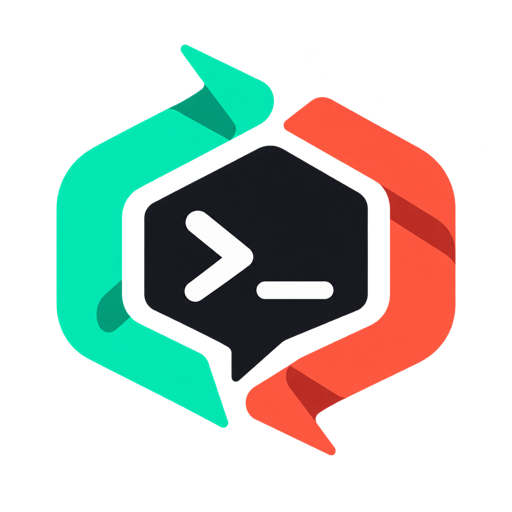
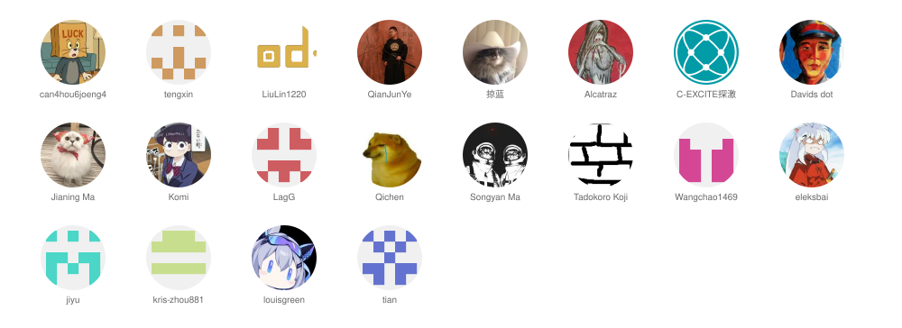
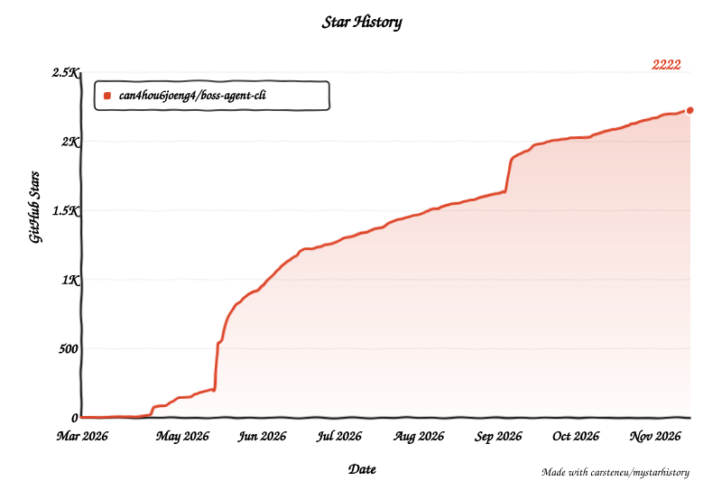

<div align="center">



# boss-agent-cli

*🤖 真人と AI エージェントのための採用プラットフォーム CLI —— ターミナルウィザード · 福利厚生フィルタリング · 2 ロールのワークフロー · JSON エンベロープ。*

[](https://python.org)
[](LICENSE)
[](https://github.com/can4hou6joeng4/boss-agent-cli/releases)
[](https://pypi.org/project/boss-agent-cli/)
[](https://github.com/can4hou6joeng4/boss-agent-cli/pulls)

[Getting Started](docs/getting-started.en.md) · [Architecture](docs/architecture.en.md) · [Agent 統合](#-agent-統合) · [コマンド](#-コマンド) · [Troubleshooting](docs/troubleshooting.en.md) · [Roadmap](ROADMAP.en.md) · [中文](README.md) | [English](README.en.md) | **日本語**

<a href="demo/showcase/boss-agent-cli-showcase.mp4" title="Watch the 48-second product keynote">
  
</a>

**[48 秒のキーノートを見る](demo/showcase/boss-agent-cli-showcase.mp4)** · [インタラクティブ版](https://can4hou6joeng4.github.io/boss-agent-cli/keynote-animation/) · [ターミナルデモ](demo/demo-en.gif) · 福利厚生フィルタリング · 2 ロールのワークフロー · エージェント統合

</div>

## 🧭 なぜ

boss-agent-cli は、求人の発見、福利厚生フィルタリング、ローカルの履歴書と AI、応募とメッセージング、採用担当者の候補者ワークフロー、再開可能なクロールを、1 つの CLI にまとめます。真人は `boss` を実行してターミナルウィザードを使い、エージェントは同じワークフローの状態に対して JSON、スキーマ、MCP、または Python API を使います。`boss schema` は引き続き能力の信頼できる唯一の情報源です。

## ⚠️ ランタイムの境界

従来の `operating_mode=assisted|research` の設定は引き続き互換性がありますが、どちらのモードも実装されたすべての能力を呼び出すことができ、モードレベルの `COMPLIANCE_BLOCKED` エラーを生成しなくなりました。未実装のプラットフォームは引き続き `NOT_SUPPORTED` を返します。認証、アカウントリスク、ネットワークの失敗には、構造化された回復メタデータが保持されます。長時間実行されるワークフローは、タイムアウト、リトライ、予算、チェックポイント、停止の各制御によって引き続き制限されます。

## ✨ 機能

- **求人の発見**：キーワード検索 + 階層フィルターと、キャッシュされた `show` ナビゲーション — `search` `show` `detail`
- **福利厚生フィルタリング（差別化要素）**：`--welfare "双休,五险一金"` はページをたどって詳細を取得し、**実際の AND マッチング**を実行します。`--sort score` でローカルのマッチスコア順に並べ替えられます — `search --welfare`
- **HR の活動状況フィルター**：`--active 3d` は、採用担当者が最近アクティブだった求人だけを残すので、一度もログインしない採用担当者に応募を費やさずに済みます。`online` は一覧のみで、通常の検索と同じリクエスト量です。一方、他のレベルは求人ごとに詳細を取得することがあり、遅く、よりリスクが高くなります。低リスクでの利用には `--active online` をおすすめします — `search --active`
- **ターミナルウィザード**：`boss` または `boss wizard` を実行し、ロール、プラットフォーム、ゴールを選択してから、JSON、実行 ID、または MCP を通じて同じワークフローを再開します
- **ローカルの候補リストと統計**：詳細を確認し、Web でお気に入りに入れた求人を有効性のステータス付きで読み、アクティブなエントリのみを同期し、ローカルのタグとメモで候補者を整理し、求人をオフラインで比較し、ファネルの統計を見られます — `shortlist` `stats` `watch` `preset` `favorites`
- **AI 就活アシスト + ローカルモデル**：JD 分析、履歴書のブラッシュアップ、ロールに合わせた最適化、キーワード提案、履歴書の最適化、候補リストの適合レポート、面接対策、チャットコーチング。ローカルの重みは、Ollama / vLLM の OpenAI 互換エンドポイント経由で Python パッケージの外に置かれます — `ai analyze-jd` `ai suggest-keywords` `ai resume-optimize` `ai interview-prep` `ai chat-coach` `ai local configure` `ai local smoke`
- **スキーマファースト + JSON エンベロープ**：stdout は JSON のみの `{ok, schema_version, command, data, pagination, error, hints}` という 7 キーのエンベロープで、`boss schema` が能力の信頼できる唯一の情報源です。また、**80 個のツールを備えた MCP サーバー**が、実装済みのツールの能力を公開します
- **採用担当者のワークフロー**：採用担当者の身元を確認してから、候補者検索、レコメンド、最初のコンタクト（既読ステータスを変えずに）、履歴書、チャット、返信、求人管理を行えます — `hr whoami/candidates/recommendations/greet/location/applications/resume/chat/last-messages/reply/request-resume/accept-resume/download-resume/jobs`
- **プラットフォーム層**：グローバルな `--platform` オプションの背後にある、稼働中の `Platform` / `RecruiterPlatform` レジストリ。`zhipin`（BOSS 直聘）が唯一の登録済みプラットフォームです

## 🚀 クイックスタート

```bash
# Install (uv recommended; the browser core is only for user-triggered login / local export)
uv tool install boss-agent-cli
boss doctor   # prints a runnable browser-kernel install command when missing

# Human entrypoint: choose role, platform, and goal in the wizard
boss

# Agents and advanced users can still call commands directly
boss doctor                                                   # environment check
boss login                                                    # platform-aware login
boss status                                                   # verify login
boss search "Golang" --city 广州 --welfare "双休,五险一金"     # search + welfare filtering
boss search "Golang" --city 广州 --active 3d                  # only recruiters active in the last 3 days
boss detail <security_id>                                     # view detail
boss shortlist add <security_id> <job_id> --tags backend,remote  # add to local shortlist with local tags
boss shortlist compare --tag remote                           # compare shortlisted jobs offline
boss stats                                                    # local stats

# Recruiter mode
boss hr candidates "Python" --city 101010100
boss hr recommendations --job-id <encJobId>
boss hr jobs list
```

すべてのコマンドは構造化された JSON を出力します（成功時は `ok`、デフォルトでは `exit 0/1`。オプションの `--exit-codes sysexits` は、エラークラスごとに意味のある終了コードを返します）。詳しい手順：[Getting Started](docs/getting-started.en.md)。

## 🎭 ロールとプラットフォーム

| プラットフォーム | 求職者 | 採用担当者 | ステータス |
|----------|:--:|:--:|--------|
| BOSS 直聘 (`zhipin`) | ✅ | ✅ | デフォルト |

```bash
boss platforms                             # list registered platforms and capability status (currently zhipin only)
boss --platform zhipin search "Python"     # zhipin is the default, so --platform can be omitted
```

`boss hr ...` と採用担当者側の `agent` 自動化は、現在 `zhipin-recruiter` のみに対応しています。アーキテクチャの説明：[docs/platform-abstraction.en.md](docs/platform-abstraction.en.md)。

## 🤖 Agent 統合

ここから始めてください：[Agent Quickstart](docs/agent-quickstart.en.md) · [Capability Matrix](docs/capability-matrix.en.md) · [Host Examples](docs/agent-hosts.en.md)

```json
// Option 1: MCP (recommended) — Claude Desktop / Cursor and other MCP hosts; MCP server with 80 tools
{ "mcpServers": { "boss-agent": { "command": "uvx", "args": ["--from", "boss-agent-cli[mcp]", "boss-mcp"] } } }
```

ローカルの Python ツールチェーンをセットアップしたくない場合は、同梱のコンテナを使ってください：`BOSS_UID=$(id -u) BOSS_GID=$(id -g) docker compose run --rm boss-mcp`。このイメージは意図的にブラウザカーネルを同梱していません。まずホスト上で `boss login` を実行してから、`~/.boss-agent` をマウントしてください。[Docker 統合](docs/integrations/docker.md)をご覧ください。

OpenCode は、チェックインされている例をそのまま使えます：

```bash
cp examples/opencode/opencode.json ./opencode.json
uv sync --all-extras
uv run boss-mcp --data-dir ./.boss-agent --help
```

ポータブル／グローバルインストールの後、バンドルの `examples/opencode.json` を任意の OpenCode プロジェクトにコピーしてください。これは `boss-mcp --data-dir ./.boss-agent` を起動し、レビュー、保留、ログをプロジェクトローカルに保ちます。

```bash
# Option 2: subprocess — let the Agent read the self-description, then parse stdout JSON
boss schema
```

```python
# Option 3: embed in Python (ships with py.typed)
from boss_agent_cli import AuthManager, BossClient, AuthRequired
with BossClient(AuthManager(...)) as client:
    result = client.search_jobs("Golang", city="北京")
```

## 📚 コマンド

`boss schema` は、ワークフローごとにグループ化された、39 個のトップレベルコマンド + 15 個の第 1 階層の採用担当者サブコマンドを公開します：

- **認証**：`login` · `logout` · `status` · `doctor`
- **発見**：`search` · `recommend` · `detail` · `show` · `cities` · `history`
- **整理**：`watch` · `preset` · `shortlist` · `stats` · `favorites`
- **再開可能なクロール**：`crawl configure/run/start/status/results/resume/stop/shortlist`
- **履歴書 / AI**：`resume` · `me` · `ai analyze-jd` · `ai polish` · `ai optimize` · `ai fit` · `ai suggest-keywords` · `ai resume-optimize` · `ai cover-letter` · `ai interview-prep` · `ai chat-coach` · `ai local`
- **ユーティリティ / ワークフロー**：`wizard` · `schema` · `platforms` · `export` · `config` · `clean`
- **求職者のアクション**：`greet` · `batch-greet` · `apply` · `exchange` · `chat` · `chatmsg` · `chat-summary` · `mark` · `interviews` · `pipeline` · `digest` · `follow-up`
- **採用担当者**：`hr whoami/applications/candidates/recommendations/greet/location/resume/chat/chatmsg/last-messages/reply/request-resume/accept-resume/download-resume/jobs`

コマンドの完全な表、パラメーター、福利厚生マッチングの内部については、**[コマンドリファレンス](docs/commands.en.md)**をご覧ください。能力の信頼できる唯一の情報源は `boss schema` です（`--format openai-tools` / `anthropic-tools` / `mcp-tools` のエクスポートに対応）。

一括クロールには `pip install "boss-agent-cli[crawl]"`（または `uv tool install "boss-agent-cli[crawl]"`。ソースのチェックアウト内では `uv sync --extra crawl`）が必要です。独自の `<data-dir>/crawl/chrome-profile` を使い、日常使いの Chrome プロファイルに接続することはありません。フックはデフォルトで無効です。ローカルスクリプトには、明示的なプロファイルと、`SHA256SUMS` を含むディレクトリの両方が必要です：

```powershell
boss crawl configure --max-requests 20 --max-details 50 --max-seconds 600 --max-retries 1
boss crawl run "AI" --city 杭州 --pages 3 --with-detail `
  --hook-profile screenshot-full --hook-dir E:\boss-agent-cli-local-hooks\AntiDebug_Breaker
boss crawl resume <run_id>
boss crawl stop <run_id>
boss agent crawl --run-id <run_id> --resume <resume-name>
```

`crawl run` は逐次実行で、SQLite の状態をチェックポイントし、JSON / CSV / XLSX の成果物を増分的に書き出します。リクエスト、詳細、実時間、リトライの予算は固定です。`boss crawl stop` は次の安全なポイントで停止します。エクスポートと `crawl results` は `security_id`、セレクター、採用担当者のフィールドを秘匿します。`boss clean --privacy` はクロールの状態、予算、エクスポートを削除します。きめ細かな MCP クロールツールは、既存の `run_id` を読み込むかインポートします。`boss_wizard` は、共有されたワークフローを開始、再開、停止できます。プラットフォームのリスクコードやセキュリティページに当たると、タスクを停止して再開コマンドを返します。

## 🩺 トラブルシューティング

```bash
boss doctor             # environment check
boss status --live      # optional low-frequency read-only probe
boss doctor --live-probe
```

すべてのエラーエンベロープは `code` + `recoverable` + `recovery_action` を持つので、エージェントはプログラムで反応できます。`boss doctor` は CDP の到達性を確認し、`browser_channel` の概要を報告します。デフォルトの `auto` ソースでは、`chat` と `chatmsg` は保存された認証情報とともに httpx を使います。`--browser-source existing-browser` を明示的に選択すると、CLI に保存された Cookie を読まずに、CDP を通じて対象サイトの既存のタブを再利用します。existing-browser の候補を使い果たすと `BROWSER_SESSION_NOT_FOUND` と `boss doctor` を返し、一方で通常の未認証の経路は引き続き `AUTH_REQUIRED` と `boss login` を返します。どのソースも、プラットフォームのリスク管理によるブロックで停止し、ワークフローをチェックポイントします。宣言されたアダプターは、制限され、秘匿され、停止可能であり、リスク条件が解決された後にのみ明示的に再開されなければなりません。

**v3.0.0 の移行：Browser Bridge デーモン、Chrome 拡張機能、`[bridge]` インストール用 extra は削除されました。CLI をアップグレードしても、古いデーモンが停止したり、ブラウザ拡張機能がアンインストールされたりすることはありません。** 古いデーモンを手動で停止し、古い拡張機能を無効化または削除し、インストールコマンドから `[bridge]` を外してください。デフォルトのブラウザのフォールバックチェーンは CDP → ヘッドレスです。既存のセッションのみを再利用するには、まずローカルの CDP ブラウザで公式サイトに手動でログインしてから、次を実行してください：

```bash
boss --browser-source existing-browser --cdp-url http://localhost:9222 chat
```

このソースは、ページを作成したり、ナビゲートしたり、Cookie を注入したり、ブラウザを起動したりしません。CDP のデバッグポートは信頼できるローカル環境内に保ち、決して公開したり、プラットフォームのリスク管理を回避するために使ったりしないでください。

完全なチェック、CDP の起動例、エラーコードについては、**[Troubleshooting](docs/troubleshooting.en.md)**をご覧ください。Cookie / CDP / patchright / リクエストレート / ドリフトの問題については、まず [Platform Risk Boundaries](docs/platform-risk.en.md) をお読みください。

## ⚙️ 設定

```bash
boss config list                      # view all settings
boss config set log_level debug       # set the log level
boss config reset log_level           # restore one setting to its default
```

設定は `~/.boss-agent/config.json` にあります：リクエストの遅延、一括グリートの遅延、ログレベル、CDP の URL、エクスポートディレクトリ、プラットフォーム / ロール。

## 🏗️ アーキテクチャ

```
CLI (Click)
  └─ Wizard / WorkflowRunner (TTY + headless JSON + persisted run state)
       └─ Capability metadata (assisted / research compatibility; no mode gate)
       └─ AuthManager ── user-triggered login state (Fernet + PBKDF2 machine-bound encryption)
       └─ Platform registries ── zhipin / zhipin-recruiter
       └─ BossClient ── httpx + throttle; CDP / patchright compatible for login & export
       └─ CacheStore (SQLite WAL) · AIService (OpenAI-compatible / Ollama / vLLM)
            └─ output.py → JSON envelope → stdout
```

**不変条件**：stdout は JSON のみ · stderr はログを保持 · `exit 0/1`（意味のあるコードにはオプションの `--exit-codes sysexits`） · エラーは `code/recoverable/recovery_action` を持つ · `boss schema` が権威ある能力の情報源です。
**2 つの受け手、1 つのエンベロープ**：`hints.next_actions` はエージェントが実行する後続コマンドを保持し、`hints.operator_actions` は人間のオペレーター向けの自然言語のガイダンス（QR コードのスキャン、ブラウザでのフィルター調整など、ターミナルの外で行うすべて）を保持します。TTY は後者のみを stderr にレンダリングします。エージェントはそれをオペレーターに転送すべきです。
**コマンドかウィザードか**：単発でステートレスな能力の呼び出しはトップレベルコマンドを通り、ステップをまたぐ状態、再開可能性、または人間へのガイダンスの受け渡しを必要とするものは `boss wizard` を通ります（ゴールは `boss schema` の `wizard_catalog` に列挙されています）。
**スタック**：Python ≥ 3.11 · Click · httpx · patchright / CDP（ログイン、エクスポート、宣言されたブラウザアダプター） · cryptography · sqlite3 (WAL) · pytest (2900+)。

## 🔌 ローカルストレージ

すべての状態は `~/.boss-agent/` の下にあります —— 暗号化されたトークン、キャッシュされた検索、候補リスト、ローカルの履歴書、AI の設定、外部モデルのレジストリ。モデルの重みは Python パッケージに同梱されません。明示的な API 呼び出しや、ユーザーが確認したモデルのダウンロードを除いて、あなたのマシンから出ていくものはありません。

## 🤝 コントリビュート

[CONTRIBUTING.en.md](CONTRIBUTING.en.md) と [Getting Started](docs/getting-started.en.md) をご覧ください。要約：フォーク → `feat/xxx` ブランチ → テストを書く → `python scripts/quality_baseline.py`（中国語版 Windows では、先に `$env:PYTHONUTF8='1'` を設定）→ PR。再現可能なオフラインの MCP 評価は [`evals/README.md`](evals/README.md) にあります。参加することで、[行動規範](CODE_OF_CONDUCT.md)に従うことに同意したものとみなされます。

boss-agent-cli をより良くしてくれたみなさんに感謝します。ぜひフォローしてください！❤️

<a href="https://github.com/can4hou6joeng4/boss-agent-cli/graphs/contributors">
  
</a>

## ❤️ サポート

- このプロジェクトが役に立ったなら、最も直接的なサポートは [Star ⭐](https://github.com/can4hou6joeng4/boss-agent-cli) をつけることか、就活中の誰かに共有することです。
- 問題に当たったり、アイデアがあったりしますか？[Issue](https://github.com/can4hou6joeng4/boss-agent-cli/issues) を開くか、そのまま PR に進んでください。セキュリティの脆弱性については、[SECURITY.md](SECURITY.md) から非公開で報告してください —— 公開の Issue は開かないでください。
- 助けが必要ですか？まずは [Getting Support](SUPPORT.en.md) から：ドキュメントの入口、Discussions、Issues、非公開のセキュリティ報告。
- 他のプロジェクトも気になりますか？母港 [bobochang.cn](https://bobochang.cn) に錨を下ろしてください 🧭。

このプロジェクトは [geekgeekrun](https://github.com/geekgeekrun/geekgeekrun) · [boss-cli](https://github.com/jackwener/boss-cli) · [opencli](https://github.com/jackwener/opencli) の恩恵を受けています —— みなさんに感謝します。

## ⭐ Star 履歴

<picture>
  <source media="(prefers-color-scheme: dark)" srcset="docs/assets/star-history-dark.svg">
  
</picture>

[mystarhistory](https://github.com/carsteneu/mystarhistory) を使ってローカルで生成した静的な SVG です —— このリポジトリから配信され、サードパーティへの依存はありません。

## ⚠️ 免責事項

適用される法律、プラットフォームの規約、プライバシー要件に従ってください。一括アウトリーチ、候補者データ、ブラウザ適応のワークフローには、明示的な入力、量、タイムアウト、停止の制限を設定し、ローカルの認証情報とエクスポートした成果物を保護してください。

## 📑 ライセンスとコミュニティ

[MIT](LICENSE) © [can4hou6joeng4](https://github.com/can4hou6joeng4) · [LINUX DO](https://linux.do/)
