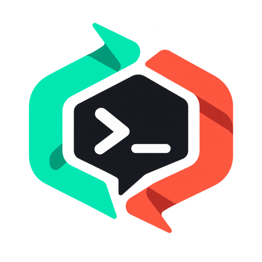
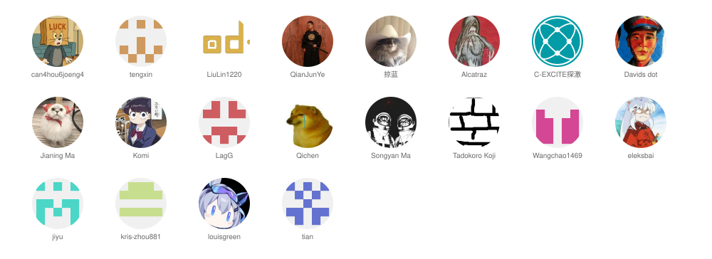
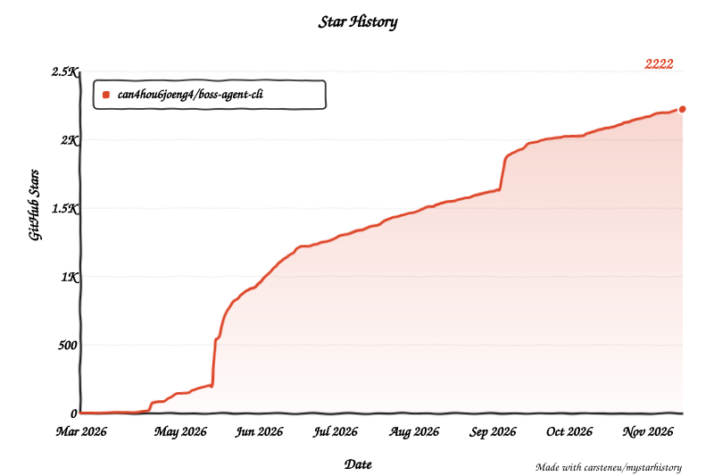

<div align="center">



# boss-agent-cli

*🤖 İnsanlar ve yapay zeka ajanları için bir işe alım platformu CLI aracı — terminal sihirbazı · yan hak filtreleme · çift rollü iş akışları · JSON zarfları.*

[](https://python.org)
[](LICENSE)
[](https://github.com/can4hou6joeng4/boss-agent-cli/releases)
[](https://pypi.org/project/boss-agent-cli/)
[](https://github.com/can4hou6joeng4/boss-agent-cli/pulls)

[Başlangıç](docs/getting-started.en.md) · [Mimari](docs/architecture.en.md) · [Agent Entegrasyonu](#-agent-entegrasyonu) · [Komutlar](#-komutlar) · [Sorun Giderme](docs/troubleshooting.en.md) · [Yol Haritası](ROADMAP.en.md) · [中文](README.md) | [English](README.en.md) | **Türkçe**

<a href="demo/showcase/boss-agent-cli-showcase.mp4" title="48 saniyelik ürün tanıtımını izleyin">
  
</a>

**[48 saniyelik tanıtımı izleyin](demo/showcase/boss-agent-cli-showcase.mp4)** · [etkileşimli sürüm](https://can4hou6joeng4.github.io/boss-agent-cli/keynote-animation/) · [terminal demosu](demo/demo-en.gif) · yan hak filtreleme · çift rollü iş akışları · ajan entegrasyonu

</div>

## 🧭 Neden

boss-agent-cli; iş ilanı keşfi, yan hak filtreleme, yerel özgeçmişler ve yapay zeka, başvuru ve mesajlaşma, işe alım uzmanı aday iş akışları ve kaldığı yerden devam edebilen taramayı (crawling) tek bir CLI'da birleştirir. İnsanlar terminal sihirbazı için `boss` komutunu çalıştırır; ajanlar ise aynı iş akışı durumu üzerinde JSON, şema, MCP veya Python API'sini kullanır. `boss schema`, yetenekler için tek doğruluk kaynağı olmaya devam eder.

## ⚠️ Çalışma Zamanı Sınırı

Geçmiş `operating_mode=assisted|research` yapılandırması uyumlu kalmaya devam eder, ancak her iki mod da uygulanan tüm yetenekleri çağırabilir ve artık mod düzeyinde `COMPLIANCE_BLOCKED` hataları üretmez. Eksik platform uygulamaları hâlâ `NOT_SUPPORTED` döndürür; kimlik doğrulama, hesap riski ve ağ hataları yapılandırılmış kurtarma meta verilerini korur. Uzun süren iş akışları zaman aşımı, yeniden deneme, bütçe, kontrol noktası ve durdurma kontrolleriyle sınırlandırılmıştır.

## ✨ Özellikler

- **İş ilanı keşfi**: anahtar kelime araması + katmanlı filtreler ve önbelleğe alınmış `show` gezinmesi — `search` `show` `detail`
- **Yan hak filtreleme (ayırt edici özellik)**: `--welfare "双休,五险一金"` sayfalama yapar, ayrıntıları çeker, **gerçek AND eşleştirmesi** çalıştırır ve yerel eşleşme puanına göre `--sort score` ile sıralayabilir — `search --welfare`
- **İK etkinliği filtresi**: `--active 3d` yalnızca işe alım uzmanı yakın zamanda aktif olan ilanları tutar, böylece hiç giriş yapmayan işe alım uzmanlarına başvuru harcamazsınız; `online` yalnızca liste bazlıdır ve düz bir aramayla aynı istek hacmine sahiptir, diğer düzeyler ise ilan başına ayrıntı çekebileceğinden daha yavaş ve risklidir — düşük riskli kullanım için `--active online` tercih edin — `search --active`
- **Terminal sihirbazı**: `boss` veya `boss wizard` komutunu çalıştırın, bir rol, platform ve hedef seçin, ardından aynı iş akışını JSON, çalıştırma kimlikleri (run ID) veya MCP aracılığıyla sürdürün
- **Yerel kısa liste ve istatistikler**: ayrıntıları inceleyin, web'de favorilere eklenen ilanları geçerlilik durumuyla okuyun ve yalnızca aktif girişleri senkronize edin, adayları yerel etiketler ve notlarla düzenleyin, ilanları çevrimdışı karşılaştırın ve huni istatistiklerini görün — `shortlist` `stats` `watch` `preset` `favorites`
- **Yapay zeka iş arama desteği + yerel modeller**: JD analizi, özgeçmiş parlatma, role özel optimizasyon, anahtar kelime önerileri, özgeçmiş optimizasyonu, kısa liste uyum raporları, mülakat hazırlığı, sohbet koçluğu; yerel ağırlıklar Ollama/vLLM OpenAI uyumlu uç noktalar aracılığıyla Python paketinin dışında kalır — `ai analyze-jd` `ai suggest-keywords` `ai resume-optimize` `ai interview-prep` `ai chat-coach` `ai local configure` `ai local smoke`
- **Şema öncelikli + JSON zarfı**: stdout yalnızca JSON içeren `{ok, schema_version, command, data, pagination, error, hints}` yedi anahtarlı bir zarftır, `boss schema` yeteneklerin doğruluk kaynağıdır ve **90 araçlı bir MCP sunucusu** uygulanan araç yeteneklerini dışa açar
- **İşe alım uzmanı iş akışı**: işe alım uzmanı kimliğini doğrulayın, ardından aday arama, öneriler, ilk temas (okundu durumunu değiştirmeden), özgeçmişler, sohbetler, yanıtlar ve ilan yönetimi — `hr whoami/candidates/recommendations/greet/location/applications/resume/chat/last-messages/reply/request-resume/accept-resume/download-resume/jobs`
- **Platform katmanı**: genel `--platform` seçeneğinin arkasında canlı `Platform` / `RecruiterPlatform` kayıt defterleri; `zhipin` (BOSS Zhipin) şu anda kayıtlı tek platformdur

## 🚀 Hızlı Başlangıç

```bash
# Kurulum (uv önerilir; tarayıcı çekirdeği yalnızca kullanıcı tarafından tetiklenen giriş / yerel dışa aktarma içindir)
uv tool install boss-agent-cli
boss doctor   # eksik olduğunda çalıştırılabilir bir tarayıcı çekirdeği kurulum komutu yazdırır

# İnsan giriş noktası: sihirbazda rol, platform ve hedef seçin
boss

# Ajanlar ve ileri düzey kullanıcılar komutları doğrudan çağırabilir
boss doctor                                                   # ortam kontrolü
boss login                                                    # platforma duyarlı giriş
boss status                                                   # girişi doğrula
boss search "Golang" --city 广州 --welfare "双休,五险一金"     # arama + yan hak filtreleme
boss search "Golang" --city 广州 --active 3d                  # yalnızca son 3 günde aktif olan işe alım uzmanları
boss detail <security_id>                                     # ayrıntıları görüntüle
boss shortlist add <security_id> <job_id> --tags backend,remote  # yerel etiketlerle yerel kısa listeye ekle
boss shortlist compare --tag remote                           # kısa listedeki ilanları çevrimdışı karşılaştır
boss stats                                                    # yerel istatistikler

# İşe alım uzmanı modu
boss hr candidates "Python" --city 101010100
boss hr recommendations --job-id <encJobId>
boss hr jobs list
```

Her komut yapılandırılmış JSON çıktısı verir (başarı için `ok`, varsayılan olarak `exit 0/1`; isteğe bağlı `--exit-codes sysexits` hata sınıfına göre anlamsal çıkış kodları döndürür). Tam adım adım kılavuz: [Başlangıç](docs/getting-started.en.md).

## 🎭 Roller ve Platformlar

| Platform | Aday | İşe Alım Uzmanı | Durum |
|----------|:--:|:--:|--------|
| BOSS Zhipin (`zhipin`) | ✅ | ✅ | varsayılan |

```bash
boss platforms                             # kayıtlı platformları ve yetenek durumunu listele (şu anda yalnızca zhipin)
boss --platform zhipin search "Python"     # zhipin varsayılan olduğundan --platform atlanabilir
```

`boss hr ...` ve işe alım uzmanı tarafındaki `agent` otomasyonu şu anda yalnızca `zhipin-recruiter` platformunu destekler. Mimari notları: [docs/platform-abstraction.en.md](docs/platform-abstraction.en.md).

## 🤖 Agent Entegrasyonu

Buradan başlayın: [Agent Hızlı Başlangıç](docs/agent-quickstart.en.md) · [Yetenek Matrisi](docs/capability-matrix.en.md) · [Konak Örnekleri](docs/agent-hosts.en.md)

```json
// Seçenek 1: MCP (önerilen) — Claude Desktop / Cursor ve diğer MCP konakları; 90 araçlı MCP sunucusu
{ "mcpServers": { "boss-agent": { "command": "uvx", "args": ["--from", "boss-agent-cli[mcp]", "boss-mcp"] } } }
```

Yerel bir Python araç zinciri kurmamayı mı tercih ediyorsunuz? Paketle gelen konteyneri kullanın: `BOSS_UID=$(id -u) BOSS_GID=$(id -g) docker compose run --rm boss-mcp`. Görüntü kasıtlı olarak tarayıcı çekirdeği içermez — önce konakta `boss login` çalıştırın, ardından `~/.boss-agent` dizinini bağlayın. [Docker entegrasyonuna](docs/integrations/docker.md) bakın.

OpenCode depodaki örneği doğrudan kullanabilir:

```bash
cp examples/opencode/opencode.json ./opencode.json
uv sync --all-extras
uv run boss-mcp --data-dir ./.boss-agent --help
```

Taşınabilir/genel kurulumdan sonra paketteki `examples/opencode.json` dosyasını herhangi bir OpenCode projesine kopyalayın. `boss-mcp --data-dir ./.boss-agent` komutunu başlatarak inceleme, bekleyenler ve günlükleri projeye özel (yerel) tutar.

```bash
# Seçenek 2: alt süreç (subprocess) — Ajanın kendi kendini tanımlamayı okumasını sağlayın, ardından stdout JSON çıktısını ayrıştırın
boss schema
```

```python
# Seçenek 3: Python içine gömün (py.typed ile birlikte gelir)
from boss_agent_cli import AuthManager, BossClient, AuthRequired
with BossClient(AuthManager(...)) as client:
    result = client.search_jobs("Golang", city="北京")
```

## 📚 Komutlar

`boss schema`, iş akışına göre gruplandırılmış 39 üst düzey komut + 15 birinci düzey işe alım uzmanı alt komutu sunar:

- **Kimlik Doğrulama**: `login` · `logout` · `status` · `doctor`
- **Keşif**: `search` · `recommend` · `detail` · `show` · `cities` · `history`
- **Düzenleme**: `watch` · `preset` · `shortlist` · `stats` · `favorites`
- **Sürdürülebilir tarama**: `crawl configure/run/start/status/results/resume/stop/shortlist`
- **Özgeçmiş / Yapay Zeka**: `resume` · `me` · `ai analyze-jd` · `ai polish` · `ai optimize` · `ai fit` · `ai suggest-keywords` · `ai resume-optimize` · `ai cover-letter` · `ai interview-prep` · `ai chat-coach` · `ai local`
- **Yardımcı / iş akışı**: `wizard` · `schema` · `platforms` · `export` · `config` · `clean`
- **Aday eylemleri**: `greet` · `batch-greet` · `apply` · `exchange` · `chat` · `chatmsg` · `chat-summary` · `mark` · `interviews` · `pipeline` · `digest` · `follow-up`
- **İşe alım uzmanı**: `hr whoami/applications/candidates/recommendations/greet/location/resume/chat/chatmsg/last-messages/reply/request-resume/accept-resume/download-resume/jobs`

Tam komut tabloları, parametreler ve yan hak eşleştirme iç yapısı: **[Komut Referansı](docs/commands.en.md)**. Yeteneklerin doğruluk kaynağı `boss schema`dır (`--format openai-tools` / `anthropic-tools` / `mcp-tools` dışa aktarımlarıyla).

Toplu tarama için `pip install "boss-agent-cli[crawl]"` (veya `uv tool install "boss-agent-cli[crawl]"`; kaynak kod içinde `uv sync --extra crawl`) gerekir. Kendi `<data-dir>/crawl/chrome-profile` dizinini kullanır ve günlük bir Chrome profiline asla bağlanmaz. Kancalar (hooks) varsayılan olarak devre dışıdır; yerel betikler hem açık bir profil hem de `SHA256SUMS` içeren bir dizin gerektirir:

```powershell
boss crawl configure --max-requests 20 --max-details 50 --max-seconds 600 --max-retries 1
boss crawl run "AI" --city 杭州 --pages 3 --with-detail `
  --hook-profile screenshot-full --hook-dir E:\boss-agent-cli-local-hooks\AntiDebug_Breaker
boss crawl resume <run_id>
boss crawl stop <run_id>
boss agent crawl --run-id <run_id> --resume <resume-name>
```

`crawl run` sıralıdır, SQLite durumuna kontrol noktası (checkpoint) koyar ve JSON / CSV / XLSX çıktılarını artımlı olarak yazar. İstek, ayrıntı, gerçek zaman ve yeniden deneme bütçeleri sabittir; `boss crawl stop` bir sonraki güvenli noktada durur. Dışa aktarımlar ve `crawl results`; `security_id`, seçiciler ve işe alım uzmanı alanlarını sansürler; `boss clean --privacy` tarama durumunu, bütçeleri ve dışa aktarımları siler. Ayrıntılı MCP tarama araçları mevcut bir `run_id`yi okur veya içe aktarır; `boss_wizard` paylaşılan iş akışını başlatabilir, sürdürebilir ve durdurabilir. Bir platform risk kodu veya güvenlik sayfası görevi durdurur ve bir sürdürme komutu döndürür.

## 🩺 Sorun Giderme

```bash
boss doctor             # ortam kontrolü
boss status --live      # isteğe bağlı düşük frekanslı salt okunur yoklama
boss doctor --live-probe
```

Her hata zarfı `code` + `recoverable` + `recovery_action` taşır, böylece ajanlar programatik olarak tepki verebilir. `boss doctor` CDP erişilebilirliğini kontrol eder ve `browser_channel` özetini raporlar. Varsayılan `auto` kaynağıyla `chat` ve `chatmsg`, saklanan kimlik bilgileriyle httpx kullanır; `--browser-source existing-browser` açıkça seçildiğinde CLI'da saklanan çerezleri okumadan CDP aracılığıyla mevcut bir hedef site sekmesini yeniden kullanır. Tükenen mevcut tarayıcı adayları `BROWSER_SESSION_NOT_FOUND` artı `boss doctor` döndürürken, normal kimlik doğrulaması yapılmamış yol yine `AUTH_REQUIRED` artı `boss login` döndürür. Her kaynak platform risk kontrolü bloklarında durur ve iş akışına kontrol noktası koyar; bildirilen bağdaştırıcılar sınırlı, sansürlü, durdurulabilir olmalı ve yalnızca risk koşulu çözüldükten sonra açıkça sürdürülmelidir.

**v3.0.0 geçişi: Browser Bridge arka plan hizmeti, Chrome uzantısı ve `[bridge]` kurulum eki kaldırılmıştır. CLI'yı yükseltmek eski bir arka plan hizmetini durdurmaz veya tarayıcı uzantısını kaldırmaz.** Eski arka plan hizmetini manuel olarak durdurun, eski uzantıyı devre dışı bırakın veya kaldırın ve kurulum komutlarından `[bridge]` ekini çıkarın. Varsayılan tarayıcı geri dönüş zinciri CDP → headless şeklindedir. Yalnızca mevcut bir oturumu yeniden kullanmak için önce yerel bir CDP tarayıcısında resmi siteye manuel olarak giriş yapın, ardından şunu çalıştırın:

```bash
boss --browser-source existing-browser --cdp-url http://localhost:9222 chat
```

Bu kaynak sayfa oluşturmaz, gezinmez, çerez enjekte etmez veya tarayıcı başlatmaz. CDP hata ayıklama portunu güvenilir bir yerel ortam içinde tutun; asla herkese açık hale getirmeyin veya platform risk kontrollerini atlatmak için kullanmayın.

Tam kontroller, CDP başlatma örnekleri ve hata kodları: **[Sorun Giderme](docs/troubleshooting.en.md)**. Çerez / CDP / patchright / istek hızı / sapma sorunları için önce [Platform Risk Sınırlarını](docs/platform-risk.en.md) okuyun.

## ⚙️ Yapılandırma

```bash
boss config list                      # tüm ayarları görüntüle
boss config set log_level debug       # günlük düzeyini ayarla
boss config reset log_level           # bir ayarı varsayılanına döndür
```

Ayarlar `~/.boss-agent/config.json` içinde yer alır: istek gecikmeleri, toplu selamlama gecikmesi, günlük düzeyi, CDP URL'si, dışa aktarma dizini, platform / rol.

## 🏗️ Mimari

```
CLI (Click)
  └─ Wizard / WorkflowRunner (TTY + headless JSON + kalıcı çalışma durumu)
       └─ Yetenek meta verileri (assisted / research uyumluluğu; mod kapısı yok)
       └─ AuthManager ── kullanıcı tarafından tetiklenen giriş durumu (Fernet + PBKDF2 makineye bağlı şifreleme)
       └─ Platform kayıt defterleri ── zhipin / zhipin-recruiter
       └─ BossClient ── httpx + hız sınırlama; giriş ve dışa aktarma için CDP / patchright uyumlu
       └─ CacheStore (SQLite WAL) · AIService (OpenAI uyumlu / Ollama / vLLM)
            └─ output.py → JSON zarfı → stdout
```

**Değişmezler**: stdout yalnızca JSON'dır · stderr günlükleri tutar · `exit 0/1` (anlamsal kodlar için isteğe bağlı `--exit-codes sysexits`) · hatalar `code/recoverable/recovery_action` taşır · `boss schema` yetkili yetenek kaynağıdır.
**İki hedef kitle, tek zarf**: `hints.next_actions` Ajanın çalıştıracağı takip komutlarını tutar; `hints.operator_actions` insan operatör için doğal dil rehberliğini tutar (bir QR kodu tarama, tarayıcıda filtreleri ayarlama — terminal dışında yapılan her şey). TTY yalnızca ikincisini stderr'e yazar; bir Ajan bunu operatöre iletmelidir.
**Komut veya sihirbaz**: tek seferlik, durumsuz yetenek çağrıları üst düzey komutlardan geçer; adımlar arası durum, sürdürülebilirlik veya insana rehberlik devretme gerektiren her şey `boss wizard` üzerinden geçer (hedefler `boss schema` içinde `wizard_catalog` altında listelenir).
**Yığın**: Python ≥ 3.11 · Click · httpx · patchright / CDP (giriş, dışa aktarma ve bildirilen tarayıcı bağdaştırıcıları) · cryptography · sqlite3 (WAL) · pytest (2900+).

## 🔌 Yerel Depolama

Tüm durum `~/.boss-agent/` altında saklanır — şifrelenmiş belirteçler, önbelleğe alınmış aramalar, kısa liste, yerel özgeçmişler, yapay zeka yapılandırması ve harici model kayıt defteri. Model ağırlıkları Python paketine dahil edilmez; açık API çağrıları veya kullanıcı tarafından onaylanan model indirmeleri dışında hiçbir şey makinenizden çıkmaz.

## 🤝 Katkıda Bulunma

[CONTRIBUTING.en.md](CONTRIBUTING.en.md) ve [Başlangıç](docs/getting-started.en.md) belgelerine bakın. Özetle: fork → `feat/xxx` dalı → testleri yazın → `python scripts/quality_baseline.py` (Çince Windows'ta önce `$env:PYTHONUTF8='1'` ayarlayın) → PR. Yeniden üretilebilir çevrimdışı MCP değerlendirmeleri [`evals/README.md`](evals/README.md) içinde yer alır. Katılarak [Davranış Kurallarına](CODE_OF_CONDUCT.md) uymayı kabul edersiniz.

boss-agent-cli'yi daha iyi hale getiren herkese teşekkürler — onları takip edin! ❤️

<a href="https://github.com/can4hou6joeng4/boss-agent-cli/graphs/contributors">
  
</a>

## ❤️ Destek

- Bu proje size yardımcı oluyorsa, en doğrudan destek bir [Yıldız ⭐](https://github.com/can4hou6joeng4/boss-agent-cli) vermek veya iş arayan biriyle paylaşmaktır.
- Bir sorunla mı karşılaştınız veya bir fikriniz mi var? Bir [Sorun (Issue)](https://github.com/can4hou6joeng4/boss-agent-cli/issues) açın — ya da doğrudan bir PR gönderin. Güvenlik açıkları için [SECURITY.md](SECURITY.md) aracılığıyla özel olarak bildirin — herkese açık bir sorun açmayın.
- Yardıma mı ihtiyacınız var? [Destek Alma](SUPPORT.en.md) ile başlayın: dokümantasyon giriş noktaları, Tartışmalar, Sorunlar ve özel güvenlik bildirimi.
- Filonun geri kalanını merak mı ediyorsunuz? Ana liman [bobochang.cn](https://bobochang.cn) adresine demir atın 🧭.

Bu proje [geekgeekrun](https://github.com/geekgeekrun/geekgeekrun) · [boss-cli](https://github.com/jackwener/boss-cli) · [opencli](https://github.com/jackwener/opencli) projelerinden faydalanmaktadır — hepsine teşekkürler.

## ⭐ Yıldız Geçmişi

<picture>
  <source media="(prefers-color-scheme: dark)" srcset="docs/assets/star-history-dark.svg">
  
</picture>

[mystarhistory](https://github.com/carsteneu/mystarhistory) ile yerel olarak oluşturulmuş statik bir SVG — üçüncü taraf bağımlılığı olmadan bu depodan sunulur.

## ⚠️ Sorumluluk Reddi

Geçerli yasalara, platform koşullarına ve gizlilik gereksinimlerine uyun. Toplu erişim, aday verileri ve tarayıcı uyarlama iş akışları için açık girdi, hacim, zaman aşımı ve durdurma sınırları belirleyin; yerel kimlik bilgilerini ve dışa aktarılan çıktıları koruyun.

## 📑 Lisans ve Topluluklar

[MIT](LICENSE) © [can4hou6joeng4](https://github.com/can4hou6joeng4) · [LINUX DO](https://linux.do/)
